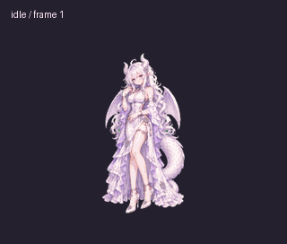
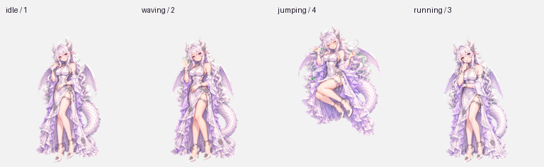

# 小龙娘 Mini · Dragon Mini Pet

白发紫瞳、银白龙角、龙翼与白尾，搭配白色礼服、长腿和饰链高跟鞋的动漫 Mini 小伙伴。面向支持自定义虚拟宠物的 Codex / ChatGPT 桌面环境，包含完整透明精灵图、动画预览和中文使用说明。



## 下载与使用

1. 下载 [assets/spritesheet.png](assets/spritesheet.png)，这是完整的透明宠物素材。
2. 在应用的「Mini 与虚拟宠物」设置里打开「创建虚拟宠物」，向支持导入的创建流程提供这张 PNG，并说明：**使用这张完整 v2 精灵图创建宠物，保留现有造型和动作。**
3. 创建后选择「小龙娘」。Windows 下可用 **Win + Alt + P** 显示 Mini。
4. 需要更小的显示效果时，在宠物菜单的 **自定义 / Customize → 宠物大小 / Pet size** 中调整。具体入口以所用应用版本为准。

自定义宠物功能及相关工具需要在所用应用中可用。可参考 [官方 Pets 文档](https://learn.chatgpt.com/docs/pets)。

## 动作与视线

共有 **9 组基础动作 + 16 个视线方向，合计 73 帧**。

基础动作包括待机、向右移动、向左移动、挥手、跳跃、失败反应、等待、工作中和查看成果。工作中通过托腮与观察手指表现思考；跳跃保持实际离地和落地衔接。



- [全部动作 GIF](previews/all-states.gif) / [MP4](previews/all-states.mp4)
- [待机 → 跳跃 → 待机](previews/idle-jump-idle.gif)
- [16 方向视线循环](previews/look-loop.gif)
- [全部帧联系图](previews/contact-sheet.png)
- [视线方向说明图](previews/look-directions.png)
- [每组动作的独立 GIF](previews/states)

相邻的部分视线动作变化较轻微，循环首尾的头部变化稍大。主要方向经三份独立盲审确认，完整精灵图也通过了格式、透明背景和动作衔接检查。

## 文件结构

```text
assets/spritesheet.png       完整透明宠物精灵图
assets/spritesheet-layout.json
previews/                   GIF、MP4、联系图与静态示例
previews/states/             9 组独立动作动画
qa/validation-summary.json  可公开的检查摘要与文件校验值
```

## 素材规格

| 项目 | 数值 |
| --- | --- |
| 布局 | v2，8 列 × 11 行 |
| 图像尺寸 | 1536 × 2288 px |
| 单格尺寸 | 192 × 208 px |
| 各行动作帧数 | 6 / 8 / 8 / 4 / 5 / 8 / 6 / 6 / 6 / 8 / 8 |
| 有效帧 / 空白格 | 73 / 15 |
| 图像格式 | 透明 PNG |

`spritesheet.png` 的 SHA-256：

```text
37655992282555e9971a40ca50433c7a4b36d893814153081ce839d35ebbda3e
```

## 制作说明

角色由 AI 生图工具辅助绘制，使用参考造型保持身份与风格；动作逐组生成，再进行透明处理、统一注册、拼装和检查。预览均从最终上传用的精灵图生成。

项目由 [chaizhaofei](https://github.com/chaizhaofei) 整理发布。
